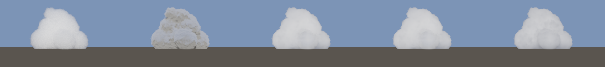
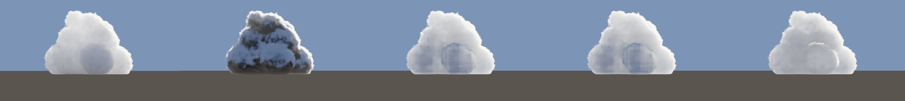

# metalnr — neural volumetric clouds on Metal 4

A replication of Charles Grassi's
[Neural Shaders, Explained With Clouds](https://charlesgrassi.dev/blog/neural-volumetric-clouds/) on Apple Silicon,
written in Objective-C++ and the Metal Shading Language on the **Metal 4** API (`MTL4CommandQueue`,
`MTL4Compiler`, argument tables, residency sets) and Metal 4 **Shader ML** (`matmul2d` from
MetalPerformancePrimitives). It renders one cumulus cloud three ways and measures them against each other:

| Method | What it is |
|---|---|
| `pt` | Path tracer (delta tracking, ratio-tracking sun NEE, Henyey–Greenstein, Russian roulette). The slow correct answer. |
| `analytic` | The article's "usual way": a ray march with HG single scattering, three Wrenninge octaves (0.4/0.35/0.1) and a two-direction ambient term. |
| `neural` | The same march, with the in-scattered light at each step predicted by a 13→16→16→3 network: hand-written MSL (`scalar`) or Metal 4 Shader ML (`shader_ml`). |

Everything except the one shade function is shared between `analytic` and `neural`: same stepping, dithering,
empty-space skipping, accumulation and early termination.

## Results

### The sun sweep (the article's experiment)

Sun swung around the cloud at 20° elevation, 480×270, each method scored against a 2×4096-spp path-traced reference.
Score = cloud luminance / reference luminance (1 = correct, <1 too dark). Full table:
[`results/sweep/report.md`](results/sweep/report.md).

| Sun angle | analytic | neural (single cloud) | neural, Shader ML | neural (generalist) |
|---|---|---|---|---|
| 0° (sun behind camera) | 0.421 | 0.933 | 0.933 | 0.774 |
| 45° | 0.432 | 0.955 | 0.955 | 0.817 |
| 90° | 0.329 | 1.022 | 1.022 | 0.852 |
| 135° | 0.281 | 0.921 | 0.921 | 0.905 |
| 180° (sun behind cloud) | 0.459 | 0.915 | 0.915 | 0.900 |

Front-lit, sun behind the camera (reference, analytic, neural single, neural Shader ML, neural generalist):



Backlit, sun at 165° behind the cloud:



- As in the article, the approximation draws the cloud **grey where it should be white**: at 0.28–0.46 of the true
  brightness across the whole sweep. The single-cloud network stays within 0.88–1.03 at every angle.
- Luminance RMSE over the cloud, front-lit: analytic 0.668, neural 0.149 (4.5×); at 90°: 0.702 vs 0.160 (4.4×);
  backlit: 1.216 vs 0.669 (1.8×). The article reported 4× front-lit and 2× elsewhere.
- Shader ML (`matmul2d`, fp16 weights, fp32 activations) matches the hand-written network to three decimals in every
  score.
- Unlike the article, our analytic version is too dark when backlit as well (0.46 at 180°, not 2.17): our
  constants and octave count differ from the shot the article measured, and the article itself notes how strongly
  the constants depend on the setup.
- The visible difference near the lower middle of the backlit images is the network spreading a forward-scattering
  peak, the case the article calls hardest.

### Generalization (held-out cloud)

A generalist network trained on 300 random cumulus shapes (seeds 1000–1299 of the 1000–1999 training range) rendered on shapes it never saw, against
accepted path-traced references (960×540; protocol in [docs/experiment-protocol.md](docs/experiment-protocol.md);
report: [`results/eval/report.md`](results/eval/report.md)):

| Scene / camera | analytic relMSE | neural relMSE | neural PSNR / SSIM | analytic / neural GPU ms |
|---|---|---|---|---|
| held-out shape (seed 2500), front | 5.80e-3 | 1.16e-3 | 44.9 dB / 0.998 | 3.3 / 6.9 |
| held-out shape (seed 2500), side | 1.17e-2 | 1.90e-3 | 43.4 dB / 0.998 | 3.0 / 6.2 |
| hand-designed cumulus, front | 7.82e-2 | 1.25e-2 | 34.4 dB / 0.995 | 12.0 / 30.3 |
| hand-designed cumulus, side | 9.88e-2 | 2.04e-2 | 33.9 dB / 0.994 | 11.3 / 25.1 |

On the Apple M1 the network costs 2–2.5× the analytic march per frame (the article measured 1.2× on an RTX 4080 with
the same hand-written approach). On this Apple7 GPU the Shader ML path is 5–20% slower than the hand-written loops,
with identical image quality.

### Metal 4 ML: what worked on this machine

- **Shader ML** (`<metal_tensor>` + `mpp::tensor_ops::matmul2d<…, execution_thread>` inside the march kernel) works
  through runtime compilation with `MTL4Compiler` on the M1. Constraints found: K must be a multiple of 16 (13 inputs
  padded to 16), single-thread N must be 1, 2, 4 or a multiple of 8 (3 outputs padded to 4), and the destination
  accumulates. GPU inference matches PyTorch within 5e-6 (scalar) and 4e-3 / 6e-3 (Shader ML, fp16 weights).
- **`MTL4MachineLearningCommandEncoder`** needs a network as an `.mtlpackage`, produced only by Apple's
  `metal-package-builder` from the Xcode Metal toolchain. On this machine the Xcode license is not accepted, so that
  path is not built: `inference: "ml_encoder"` reports unavailable. Details in
  [docs/architecture.md](docs/architecture.md) §9.

## Requirements

- Apple Silicon Mac with a Metal 4 GPU family, macOS 26 or later.
- Xcode Command Line Tools (Apple clang, the macOS SDK with the `MTL4*` headers and MetalPerformancePrimitives) and
  CMake ≥ 3.28. Xcode itself is not needed: shaders are compiled at runtime from source.
- Python 3.9+ with PyTorch, **only** to retrain the networks (`tools/requirements.txt`).

## Build and test

```sh
cmake -S . -B build -DCMAKE_BUILD_TYPE=Release
cmake --build build -j
ctest --test-dir build --output-on-failure   # runs under the Metal debug layer and shader validation
```

## Usage

```sh
./build/cloudnr info                                         # device, GPU families, timestamp frequency

# Interactive window: left-drag orbit, scroll zoom, WASD/QE pan, [ ] exposure, R reset,
# 1-4 switch renderer (density, analytic, pt, neural)
./build/cloudnr view --scene scenes/cumulus.json --config configs/neural_single.json

# Offline render to linear PFM and tone-mapped PNG (pt renders config.spp samples)
./build/cloudnr render --scene scenes/cumulus.json --camera front --config configs/neural_single_shaderml.json \
    --out out/neural.pfm --png out/neural.png

# Two-half path-traced reference with a convergence log, and image comparison (relMSE, PSNR, SSIM)
./build/cloudnr reference --scene scenes/cumulus.json --camera front --spp 4096 --out out/ref
./build/cloudnr compare --test out/neural.pfm --ref out/ref/ref.pfm --exposure 0.5 --heatmap out/neural_err

# The article's sun sweep (~10 min on an M1; --quick for a smoke run) and the held-out comparison suite
./build/cloudnr sweep --experiment experiments/sweep.json
./build/cloudnr suite --experiment experiments/eval.json
```

`render`, `view`, `compare`, `reference`, `dump-training` and `neural-check` accept `--validate` to re-run under
`MTL_DEBUG_LAYER=1 MTL_SHADER_VALIDATION=1`. Timing commands (`bench`, `suite`, `sweep`) should run without it.

### Training the networks

```sh
python3 -m venv .venv && .venv/bin/pip install -r tools/requirements.txt

# Single-cloud weights (the article's): the evaluation cloud under random suns
./build/cloudnr dump-training --fixed-shape --template scenes/cumulus.json --out data/single_train.cnrd \
    --shape-begin 1 --shape-end 2 --shapes 300 --records-per-shape 4096
./build/cloudnr dump-training --fixed-shape --template scenes/cumulus.json --out data/single_val.cnrd \
    --shape-begin 7 --shape-end 8 --shapes 32 --records-per-shape 4096
.venv/bin/python tools/train.py --train data/single_train.cnrd --val data/single_val.cnrd --out models/cumulus_single

# Generalist weights: random cumulus shapes, validated on held-out shapes
./build/cloudnr dump-training --out data/train.cnrd --shape-begin 1000 --shape-end 2000 --shapes 300 --records-per-shape 4096
./build/cloudnr dump-training --out data/val.cnrd   --shape-begin 2000 --shape-end 3000 --shapes 32  --records-per-shape 4096
.venv/bin/python tools/train.py --train data/train.cnrd --val data/val.cnrd --out models/cumulus_net

# GPU inference (scalar and Shader ML) vs PyTorch on 10,000 validation inputs
./build/cloudnr neural-check --model models/cumulus_net.cnrm --check models/cumulus_net.check.bin
```

Data generation takes under a minute per dataset on the M1 (1.2 M records at 256 paths each) and training about
40 s on MPS. Training samples come from the first collision of random camera rays and the network is fit to raw
targets, both lessons from the article. Python is never needed at render time.

## Repository layout

| Path | Contents |
|---|---|
| `src/` | Host code: Metal context and frame loop, scene/config JSON, image I/O and metrics, density bake, renderers, viewer, reference, benchmark, suite and sweep |
| `src/shaders/` | MSL: shared physics and march (`common.metal`), cumulus bake, the three renderers, neural descriptor/MLP (scalar and Shader ML), display pass |
| `tests/` | One test executable per file (CTest): scene/IO/metrics, GPU foundation, analytic closed forms, path-tracer statistics, neural loader/inference, benchmark framework |
| `scenes/`, `configs/`, `experiments/` | Scenes, renderer configs, the fixed sweep and suite experiments |
| `models/` | Trained networks (`.cnrm`), sidecar metadata and GPU parity check files |
| `tools/` | `train.py` and pinned Python requirements |
| `results/sweep/`, `results/eval/` | The sun sweep and the held-out suite: reports, CSV, JSON records, images |
| `docs/` | Architecture and experiment protocol |

Training data (`data/`), the path-traced reference images and float `.pfm` outputs are not committed; the commands
above regenerate them deterministically.

## Documentation

- [`docs/architecture.md`](docs/architecture.md): toolchain decisions, module layout, scene contract and the cumulus
  function, radiative transfer, the path tracer, the shared march and analytic model, the neural descriptor, network,
  data and training, Metal 4 APIs used (and the ML-encoder blocker), risks, milestones.
- [`docs/experiment-protocol.md`](docs/experiment-protocol.md): scenes and seed splits, the two neural tracks,
  reference acceptance, metrics, timing, memory, record schema, reporting rules and the sun sweep.

## How this was built

1. A Metal 4 foundation (device, runtime-compiled shaders, frame loop, density bake, viewer, GPU error checks), an
   analytic renderer validated against closed-form solutions, a path-traced reference with statistical tests, a first
   neural renderer and a benchmark suite.
2. A rework to replicate the article: the cumulus shape function, the article's march (dither, empty-space skip, early
   termination) and analytic constants, the 13-input descriptor with metric radii, squared-ReLU network, camera-style
   training data, raw-target training, Metal 4 Shader ML inference, and the sun-sweep evaluation.

Known limitations: the networks are valid only for albedo 0.99 and g 0.8; the sky is two bands; there is no level of
detail; the analytic constants are the article's, not refitted to this scene; the ML-encoder path needs the Xcode
Metal toolchain.

## License

MIT — see [LICENSE](LICENSE).
