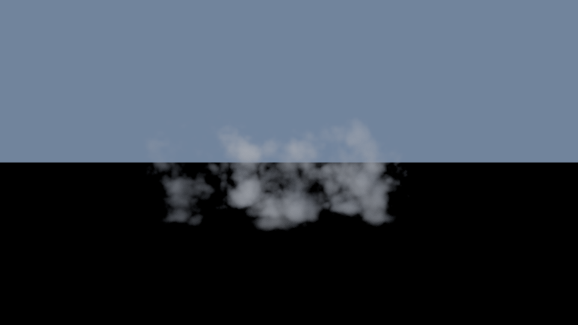
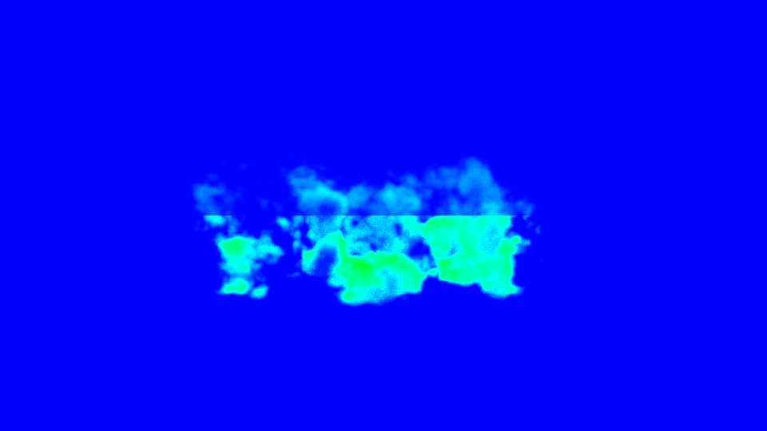
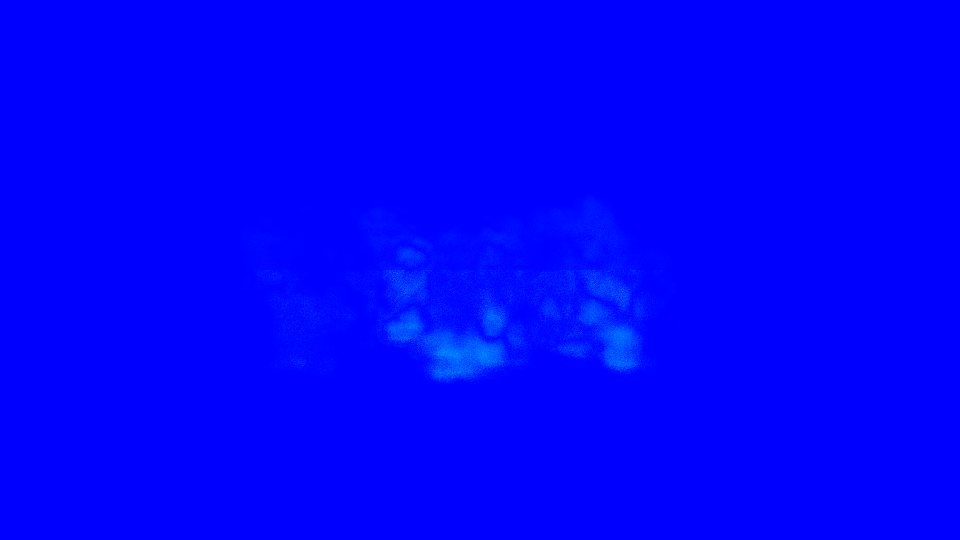

# metalnr — Metal 4 volumetric cloud renderer

A research renderer for a single volumetric cloud on Apple Silicon, written in Objective-C++ and the Metal Shading
Language on the **Metal 4** API (`MTL4CommandQueue`, `MTL4Compiler`, argument tables, residency sets). It implements
and compares three ways to render the same cloud:

| Method | What it is | Role |
|---|---|---|
| `pt` | Path tracer: delta tracking, ratio-tracking next-event estimation to the sun, Henyey–Greenstein phase, Russian roulette, progressive accumulation | Unbiased reference (apart from a counted 4096-bounce cap) |
| `analytic` | Deterministic ray march: Beer–Lambert transmittance, single scattering, Wrenninge octave multiple-scattering approximation, two-direction ambient term | Real-time baseline |
| `neural` | Same ray march, with the multiple-scattered radiance $L_{rest}$ predicted by a small MLP (Deep Scattering style, 40→32→32→32→3) running in a hand-written Metal shader | Learned real-time method |

All three share one scene definition, one procedural density field baked into a 3D texture, and one copy of the
physics (`src/shaders/common.metal`). A benchmark suite runs every method on fixed scenes and cameras and exports
GPU time, relMSE, PSNR, SSIM and memory against path-traced references.

This is an experimental renderer, not an engine.

## Results

Apple M1 (8-core GPU), macOS 27.2, 960×540. GPU time is the median over 3 runs × 300 frames (after 30 warm-up
frames) from `MTL4CommitFeedback`; errors are against a converged two-half path-traced reference whose estimated error
is at most 0.1× the best method's error. Full report: [`results/eval/report.md`](results/eval/report.md).

| Scene / camera | Method | GPU ms | relMSE | PSNR dB | SSIM |
|---|---|---|---|---|---|
| thin / side | analytic | 8.84 | 1.86e-3 | 37.27 | 0.9905 |
| | neural | 83.88 | 3.63e-6 | 62.57 | 0.9999 |
| | pt, 64 spp | 0.68 / spp | 5.11e-4 | 39.20 | 0.9615 |
| medium / side | analytic | 10.26 | 5.71e-3 | 35.46 | 0.9936 |
| | neural | 90.89 | 5.03e-5 | 54.61 | 0.9997 |
| | pt, 64 spp | 1.44 / spp | 1.65e-3 | 38.66 | 0.9619 |
| thick / backlit | analytic | 7.33 | 4.71e-3 | 37.67 | 0.9960 |
| | neural | 71.55 | 3.12e-4 | 48.73 | 0.9991 |
| | pt, 64 spp | 3.03 / spp | 4.40e-3 | 36.85 | 0.9612 |

- The neural method is 17–510× closer to the reference (relMSE) than the analytic baseline, at roughly 10× its cost. On the
  thin cloud a progressive path tracer does not reach the neural error within 4096 spp.
- The neural model was trained only on procedural scenes with density seeds 1000–1999 (validation 2000–2999);
  the evaluation scenes use seeds 1–3.
- Neural GPU time varies widely between frames (p5–p95 ≈ 45–135 ms); the cause has not been diagnosed.

| Reference (medium / backlit) | Analytic relative error | Neural relative error |
|---|---|---|
|  |  |  |

## Requirements

- Apple Silicon Mac with a Metal 4 GPU family (`MTLGPUFamilyMetal4`), macOS 26 or later.
- Xcode Command Line Tools (Apple clang, macOS SDK with the `MTL4*` headers) and CMake ≥ 3.28.
  Xcode itself is not needed: shaders are compiled at runtime from source with `MTL4Compiler`.
- Python 3.9+ with PyTorch, **only** to retrain the neural model (`tools/requirements.txt`).

## Build and test

```sh
cmake -S . -B build -DCMAKE_BUILD_TYPE=Release
cmake --build build -j
ctest --test-dir build --output-on-failure   # runs under the Metal debug layer and shader validation
```

## Usage

```sh
./build/cloudnr info                                         # device, GPU families, timestamp frequency

# Interactive window: left-drag orbit, scroll zoom, WASD/QE pan, [ ] exposure, R reset,
# 1-4 switch renderer (density, analytic, pt, neural)
./build/cloudnr view --scene scenes/eval_medium.json --config configs/analytic.json

# Offline render to linear PFM and tone-mapped PNG (pt renders config.spp samples)
./build/cloudnr render --scene scenes/eval_thick.json --camera backlit --config configs/neural.json \
    --out out/neural.pfm --png out/neural.png

# Two-half path-traced reference with a convergence log (relMSE vs spp)
./build/cloudnr reference --scene scenes/eval_thin.json --camera side --spp 4096 --out out/ref

# Compare an image with a reference (relMSE, PSNR, SSIM, optional heat maps)
./build/cloudnr compare --test out/neural.pfm --ref out/ref/ref.pfm --heatmap out/neural_err

# Benchmark one method (protocol timing, JSON record)
./build/cloudnr bench --scene scenes/eval_medium.json --camera side --config configs/analytic.json \
    --reference out/ref/ref.pfm

# Full experiment: references with acceptance gates, all methods, CSV + Markdown report
./build/cloudnr suite --experiment experiments/eval.json          # ~10 min on an M1; --quick for a smoke run
```

`render`, `view`, `compare`, `reference`, `dump-training` and `neural-check` accept `--validate` to re-run under
`MTL_DEBUG_LAYER=1 MTL_SHADER_VALIDATION=1`. Timing commands (`bench`, `suite`) should run without it and warn if it is on.

### Retraining the neural model

```sh
python3 -m venv .venv && .venv/bin/pip install -r tools/requirements.txt
./build/cloudnr dump-training --out data/train.cnrd --seed-begin 1000 --seed-end 2000 --scenes 200 --records-per-scene 2048
./build/cloudnr dump-training --out data/val.cnrd   --seed-begin 2000 --seed-end 3000 --scenes 24  --records-per-scene 2048
.venv/bin/python tools/train.py --train data/train.cnrd --val data/val.cnrd --out models/cloud_mlp
./build/cloudnr neural-check --model models/cloud_mlp.cnrm --check models/cloud_mlp.check.bin
```

Python is never needed at render time; the model is a versioned `.cnrm` file (fp16 weights) with a JSON sidecar
recording the architecture, hyperparameters, dataset hashes and seed ranges, library versions and loss curves.

### Reproducing the results

Training data (`data/`, ~90 MB), path-traced references (`results/refs/`) and float images (`*.pfm`) are not in the
repository; the commands above regenerate them deterministically (fixed seeds). `cloudnr suite` reuses references in
`results/refs/` when the scene version, camera, seeds and renderer version match.

## Repository layout

| Path | Contents |
|---|---|
| `src/` | Host code: Metal context and frame loop, scene/config JSON, image I/O and metrics, density bake, renderers, viewer, reference, benchmark and suite |
| `src/shaders/` | MSL: shared physics (`common.metal`), density bake, the three renderers, neural descriptor/MLP, display pass |
| `tests/` | One test executable per file (CTest): scene/IO/metrics, GPU foundation, analytic closed forms, path-tracer statistics, neural loader/inference, benchmark framework |
| `scenes/`, `configs/`, `experiments/` | Evaluation scenes (thin/medium/thick, cameras `side` and `backlit`), renderer configs, the fixed experiment |
| `models/` | Trained neural model, sidecar metadata and GPU parity check file |
| `tools/` | `train.py` and pinned Python requirements |
| `results/eval/` | The full comparison run: report, CSV, JSON records, PNG images and heat maps |
| `docs/` | Architecture and experiment protocol |

## Documentation

- [`docs/architecture.md`](docs/architecture.md): goals and toolchain decisions, module layout, the shared scene
  contract and JSON schema, the radiative-transfer equation and its assumptions, the three algorithms and their
  approximations, neural training targets and model format, the Metal 4 APIs used, risks, and milestones.
- [`docs/experiment-protocol.md`](docs/experiment-protocol.md): scenes and train/validation/evaluation seed splits,
  reference generation and acceptance gates, metric definitions, timing and memory methodology, benchmark record
  schema and reporting rules.

## How this was built

The project was developed in five milestones, each with its own acceptance checks
(`docs/architecture.md` §11):

1. **Metal 4 foundation**: device and queue setup, runtime shader compilation, frame loop with at most two frames in
   flight, procedural density bake with mips, a density visualization pass, an AppKit/`CAMetalLayer` viewer with
   orbit camera, and GPU error checking (debug layer plus command-buffer feedback errors). Because the development
   machine could not capture the screen, `view --autotest` drives the camera controls through the real input
   handlers and saves the presented frames.
2. **Analytic baseline**: validated against closed-form solutions for a homogeneous box (Beer–Lambert transmittance,
   single scattering with exact rays and full images, Henyey–Greenstein normalization).
3. **Path-traced reference**: statistical tests (white furnace, transmittance, phase sampling, determinism, single
   scattering matching the closed form, 1/spp convergence) and two-half references with convergence logs.
4. **Neural renderer**: GPU dataset generation with the path tracer, PyTorch training, fp16 `.cnrm` export, and
   Metal inference that matches the exported model within 3.1e-5 relative error.
5. **Benchmarking**: steady-state GPU timing from commit feedback, memory accounting, references accepted only when
   their estimated error is at most 1e-4 and 0.1× every method's error, equal-quality spp, and exported JSON/CSV/Markdown reports.

Known limitations are listed in the docs: the octave approximation is not energy-conserving, fp16 weights deviate
from the fp32 model by up to 0.13 relative error on near-zero outputs, the model is only valid for the trained phase
anisotropy and albedo, and timings on the M1 are affected by DVFS.

## License

MIT — see [LICENSE](LICENSE).
