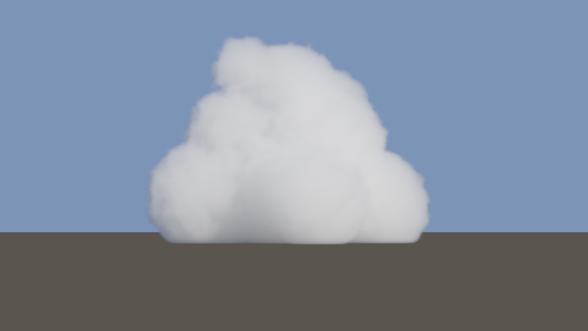
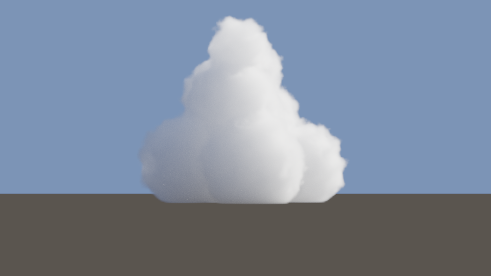
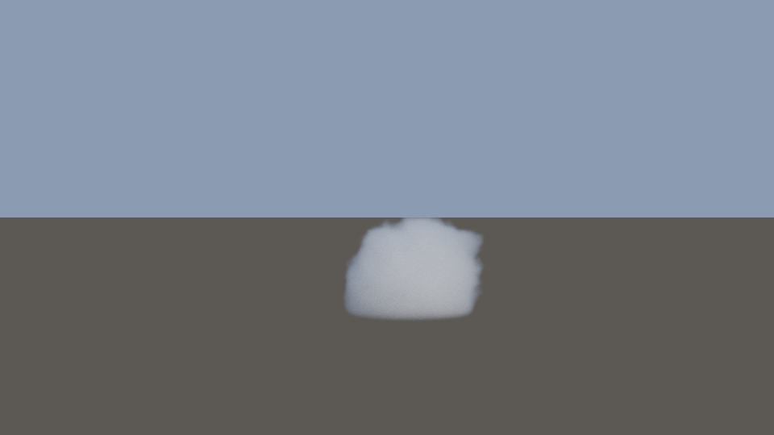
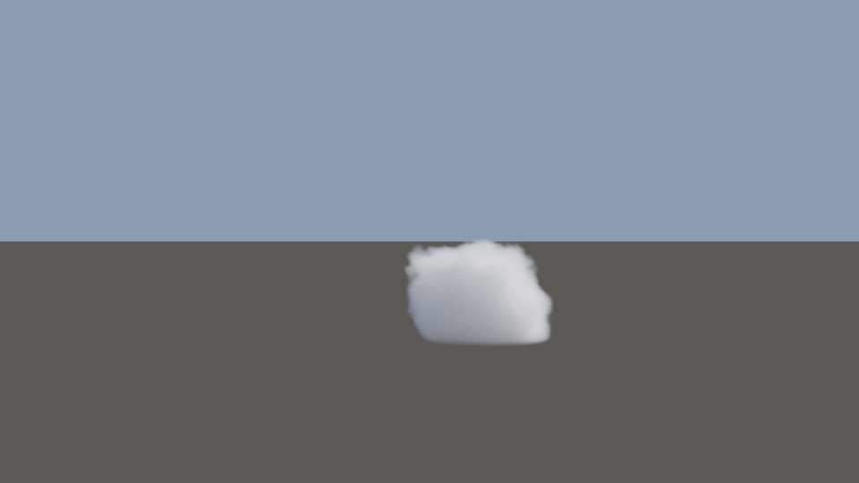

# Cloud renderer comparison: eval

| Item | Value |
|---|---|
| GPU | Apple M1 |
| OS | Version 27.2 (Build 26B123) |
| Renderer version | ad6fd7e-dirty |
| Experiment | `experiments/eval.json` sha256 `fbea8d0512a88dcfe80eaa67dadc0f6607a9f29e3c52a7b61084abfe240d7e26` |
| Timing | 30 warm-up + 300 frames x 3 runs; GPU time from MTL4CommitFeedback; headline = median of run medians; p5/p95 nearest-rank |
| Validation layer | off |
| Reference gates | est. relMSE <= 0.0001 and <= 0.1 x min method relMSE; spp per half 1024..65536 |

Metrics are against the path-traced reference (relMSE on linear radiance; PSNR and SSIM on display-mapped images). Methods run at their recorded configurations, which differ in quality settings (column *Quality*). *Equal-quality pt spp* is the first power-of-two spp at which a progressive path tracer (seed 3) reaches the method's relMSE; its GPU time is the cumulative GPU time of that run.

## cumulus / front

Reference: 32768 spp per half, est. relMSE 5.526e-05, accepted, bounce-cap hits 0, mean bounces 2.758. 

| Method | Quality | GPU ms median [p5, p95] | CPU prep ms | relMSE | PSNR dB | SSIM | Renderer MB | Equal-quality pt spp (GPU ms) |
|---|---|---|---|---|---|---|---|---|
| analytic | step 1x, 3 oct, ambient | 11.95 [9.841, 14] | 0.06704 | 0.07819 | 21.45 | 0.962 | 7.97 | 64 (713.5) |
| neural | step 1x, scalar | 30.29 [16.13, 42.63] | 0.07812 | 0.01246 | 34.37 | 0.9953 | 7.972 | 512 (5664) |
| neural_shaderml | step 1x, shader_ml | 34.78 [14.43, 46.69] | 0.07879 | 0.01247 | 34.36 | 0.9953 | 7.973 | 512 (5664) |
| pt_bench | 64 spp | 11.58 [11.37, 12.09] | 0.08396 | 0.05356 | 29.83 | 0.8314 | 7.97 | - |

- analytic: [image](images/cumulus_front_analytic.png), [abs error](images/cumulus_front_analytic_abs.png), [rel error](images/cumulus_front_analytic_rel.png)
- neural: [image](images/cumulus_front_neural.png), [abs error](images/cumulus_front_neural_abs.png), [rel error](images/cumulus_front_neural_rel.png)
- neural_shaderml: [image](images/cumulus_front_neural_shaderml.png), [abs error](images/cumulus_front_neural_shaderml_abs.png), [rel error](images/cumulus_front_neural_shaderml_rel.png)
- pt_bench: [image](images/cumulus_front_pt_bench.png), [abs error](images/cumulus_front_pt_bench_abs.png), [rel error](images/cumulus_front_pt_bench_rel.png)

## cumulus / side

Reference: 32768 spp per half, est. relMSE 7.049e-05, accepted, bounce-cap hits 0, mean bounces 2.063. 

| Method | Quality | GPU ms median [p5, p95] | CPU prep ms | relMSE | PSNR dB | SSIM | Renderer MB | Equal-quality pt spp (GPU ms) |
|---|---|---|---|---|---|---|---|---|
| analytic | step 1x, 3 oct, ambient | 11.26 [7.576, 16.03] | 0.06367 | 0.09879 | 18.3 | 0.9352 | 7.97 | 64 (491.4) |
| neural | step 1x, scalar | 25.07 [21.65, 28.5] | 0.08008 | 0.02039 | 33.9 | 0.9935 | 7.972 | 256 (1946) |
| neural_shaderml | step 1x, shader_ml | 26.28 [22.82, 28.82] | 0.07725 | 0.02038 | 33.9 | 0.9935 | 7.973 | 256 (1946) |
| pt_bench | 64 spp | 7.59 [7.477, 7.851] | 0.07854 | 0.06568 | 29.65 | 0.8727 | 7.97 | - |

- analytic: [image](images/cumulus_side_analytic.png), [abs error](images/cumulus_side_analytic_abs.png), [rel error](images/cumulus_side_analytic_rel.png)
- neural: [image](images/cumulus_side_neural.png), [abs error](images/cumulus_side_neural_abs.png), [rel error](images/cumulus_side_neural_rel.png)
- neural_shaderml: [image](images/cumulus_side_neural_shaderml.png), [abs error](images/cumulus_side_neural_shaderml_abs.png), [rel error](images/cumulus_side_neural_shaderml_rel.png)
- pt_bench: [image](images/cumulus_side_pt_bench.png), [abs error](images/cumulus_side_pt_bench_abs.png), [rel error](images/cumulus_side_pt_bench_rel.png)

## cumulus_heldout / front

Reference: 2048 spp per half, est. relMSE 5.995e-05, accepted, bounce-cap hits 0, mean bounces 0.2683. 

| Method | Quality | GPU ms median [p5, p95] | CPU prep ms | relMSE | PSNR dB | SSIM | Renderer MB | Equal-quality pt spp (GPU ms) |
|---|---|---|---|---|---|---|---|---|
| analytic | step 1x, 3 oct, ambient | 3.254 [2.608, 3.749] | 0.04246 | 0.005802 | 34.07 | 0.9951 | 7.97 | 64 (290) |
| neural | step 1x, scalar | 6.878 [6.113, 7.49] | 0.04925 | 0.001159 | 44.93 | 0.9977 | 7.972 | 256 (1138) |
| neural_shaderml | step 1x, shader_ml | 7.242 [6.546, 7.828] | 0.05262 | 0.001159 | 44.93 | 0.9977 | 7.973 | 256 (1138) |
| pt_bench | 64 spp | 4.414 [4.335, 4.523] | 0.07737 | 0.003849 | 39.89 | 0.9758 | 7.97 | - |

- analytic: [image](images/cumulus_heldout_front_analytic.png), [abs error](images/cumulus_heldout_front_analytic_abs.png), [rel error](images/cumulus_heldout_front_analytic_rel.png)
- neural: [image](images/cumulus_heldout_front_neural.png), [abs error](images/cumulus_heldout_front_neural_abs.png), [rel error](images/cumulus_heldout_front_neural_rel.png)
- neural_shaderml: [image](images/cumulus_heldout_front_neural_shaderml.png), [abs error](images/cumulus_heldout_front_neural_shaderml_abs.png), [rel error](images/cumulus_heldout_front_neural_shaderml_rel.png)
- pt_bench: [image](images/cumulus_heldout_front_pt_bench.png), [abs error](images/cumulus_heldout_front_pt_bench_abs.png), [rel error](images/cumulus_heldout_front_pt_bench_rel.png)

## cumulus_heldout / side

Reference: 2048 spp per half, est. relMSE 5.59e-05, accepted, bounce-cap hits 0, mean bounces 0.2295. 

| Method | Quality | GPU ms median [p5, p95] | CPU prep ms | relMSE | PSNR dB | SSIM | Renderer MB | Equal-quality pt spp (GPU ms) |
|---|---|---|---|---|---|---|---|---|
| analytic | step 1x, 3 oct, ambient | 3.036 [2.488, 3.556] | 0.03829 | 0.01169 | 29.21 | 0.9908 | 7.97 | 32 (119) |
| neural | step 1x, scalar | 6.205 [5.505, 6.893] | 0.04871 | 0.001899 | 43.36 | 0.9976 | 7.972 | 128 (445) |
| neural_shaderml | step 1x, shader_ml | 7.433 [6.672, 8.06] | 0.05275 | 0.001899 | 43.36 | 0.9976 | 7.973 | 128 (445) |
| pt_bench | 64 spp | 3.402 [3.334, 3.517] | 0.06579 | 0.003708 | 40.18 | 0.9804 | 7.97 | - |

- analytic: [image](images/cumulus_heldout_side_analytic.png), [abs error](images/cumulus_heldout_side_analytic_abs.png), [rel error](images/cumulus_heldout_side_analytic_rel.png)
- neural: [image](images/cumulus_heldout_side_neural.png), [abs error](images/cumulus_heldout_side_neural_abs.png), [rel error](images/cumulus_heldout_side_neural_rel.png)
- neural_shaderml: [image](images/cumulus_heldout_side_neural_shaderml.png), [abs error](images/cumulus_heldout_side_neural_shaderml_abs.png), [rel error](images/cumulus_heldout_side_neural_shaderml_rel.png)
- pt_bench: [image](images/cumulus_heldout_side_pt_bench.png), [abs error](images/cumulus_heldout_side_pt_bench_abs.png), [rel error](images/cumulus_heldout_side_pt_bench_rel.png)

## Excluded costs (not part of steady-state timing)

| Scene | Camera | Method | Compile ms | Bake ms | Model load ms | Reference GPU ms | Memory density MB | Device delta MB |
|---|---|---|---|---|---|---|---|---|
| cumulus | front | analytic | 0.318 | 28.21 | n/a | 7.552e+05 | 36 | 7.969 |
| cumulus | front | neural | 1.135 | 28.21 | 0.9387 | 7.552e+05 | 36 | 7.969 |
| cumulus | front | neural_shaderml | 1.219 | 28.21 | 1.296 | 7.552e+05 | 36 | 7.969 |
| cumulus | front | pt_bench | 1.005 | 28.21 | n/a | 7.552e+05 | 36 | 7.969 |
| cumulus | side | analytic | 0.3395 | 28.21 | n/a | 5.095e+05 | 36 | 7.969 |
| cumulus | side | neural | 1.22 | 28.21 | 1.366 | 5.095e+05 | 36 | 7.969 |
| cumulus | side | neural_shaderml | 1.446 | 28.21 | 1.448 | 5.095e+05 | 36 | 8.219 |
| cumulus | side | pt_bench | 0.6812 | 28.21 | n/a | 5.095e+05 | 36 | 7.969 |
| cumulus_heldout | front | analytic | 0.2889 | 28.22 | n/a | 1.811e+04 | 36 | 7.969 |
| cumulus_heldout | front | neural | 1.013 | 28.22 | 1.157 | 1.811e+04 | 36 | 7.969 |
| cumulus_heldout | front | neural_shaderml | 1.287 | 28.22 | 1.413 | 1.811e+04 | 36 | 7.969 |
| cumulus_heldout | front | pt_bench | 1.212 | 28.22 | n/a | 1.811e+04 | 36 | 7.969 |
| cumulus_heldout | side | analytic | 0.2898 | 28.22 | n/a | 1.395e+04 | 36 | 7.969 |
| cumulus_heldout | side | neural | 1.261 | 28.22 | 1.409 | 1.395e+04 | 36 | 7.969 |
| cumulus_heldout | side | neural_shaderml | 0.7278 | 28.22 | 0.7932 | 1.395e+04 | 36 | 7.969 |
| cumulus_heldout | side | pt_bench | 0.7895 | 28.22 | n/a | 1.395e+04 | 36 | 7.969 |

Compile times are wall time of MTL4Compiler calls and include Metal's shader cache hits.

## Bias sources

- pt: bounce cap 4096 (hits listed per reference); low-spp pt methods carry Monte Carlo noise, not bias.
- analytic: ray-march discretization, two-direction ambient term, octave multiple-scattering approximation (not energy-conserving).
- neural: ray-march discretization, network approximation of the in-scattered radiance, Monte Carlo noise in training targets; shader_ml uses fp16 activations and weights.

## Neural model

- `models/cumulus_net.cnrm` sha256 `62915273e567e2ffc83ed0f9f50b21c46eaf94ece30ac3d534f6da70f48ebb2d`, format 2
- training shape seeds 1000-1999
- best validation loss (MSE on raw targets) 0.01448, validation seeds 2000-2999
