# Sun sweep: sun_sweep

| Item | Value |
|---|---|
| Scene | `scenes/cumulus.json` (cumulus, version 3) |
| Camera | front |
| Resolution | 480 x 270 |
| Sun | azimuth around the cloud relative to the camera (0 = behind the camera, 180 = behind the cloud), elevation 20 deg |
| GPU | Apple M1 |
| OS | Version 27.2 (Build 26B123) |
| Renderer version | ad6fd7e-dirty |
| Reference | `configs/pt.json`, 4096 spp per half, seeds 1/2 |
| Timing | 30 warm-up + 300 frames x 3 runs; GPU time from MTL4CommitFeedback; median of run medians |
| Validation layer | off |

Mask: pixels where the `analytic` output alpha (1 - transmittance) exceeds 0.05. Score = sum of Rec.709 luminance of the method over the mask / the same sum for the path-traced reference (1 = matches, < 1 too dark). RMSE is the luminance RMSE over the mask (linear radiance). relMSE, PSNR and SSIM are full-image metrics against the reference with the camera exposure.

## Score

Sum of luminance over the mask relative to the reference.

| Angle (deg) | analytic | neural_single | neural_single_shaderml | neural |
|---|---|---|---|---|
| 0 | 0.421 | 0.933 | 0.933 | 0.774 |
| 15 | 0.423 | 0.935 | 0.935 | 0.786 |
| 30 | 0.427 | 0.939 | 0.939 | 0.802 |
| 45 | 0.432 | 0.955 | 0.955 | 0.817 |
| 60 | 0.426 | 0.992 | 0.992 | 0.834 |
| 75 | 0.392 | 1.029 | 1.029 | 0.853 |
| 90 | 0.329 | 1.022 | 1.022 | 0.852 |
| 105 | 0.297 | 0.975 | 0.975 | 0.832 |
| 120 | 0.278 | 0.946 | 0.946 | 0.858 |
| 135 | 0.281 | 0.921 | 0.921 | 0.905 |
| 150 | 0.317 | 0.879 | 0.879 | 0.899 |
| 165 | 0.393 | 0.945 | 0.945 | 0.945 |
| 180 | 0.459 | 0.915 | 0.915 | 0.900 |
| Mean | 0.375 | 0.953 | 0.953 | 0.851 |

## Luminance RMSE

Over the mask, linear radiance.

| Angle (deg) | analytic | neural_single | neural_single_shaderml | neural |
|---|---|---|---|---|
| 0 | 0.6684 | 0.1491 | 0.149 | 0.2942 |
| 15 | 0.6503 | 0.1541 | 0.1541 | 0.2793 |
| 30 | 0.6218 | 0.1591 | 0.1591 | 0.2588 |
| 45 | 0.5943 | 0.1534 | 0.1534 | 0.2436 |
| 60 | 0.59 | 0.1488 | 0.1488 | 0.2324 |
| 75 | 0.6295 | 0.1603 | 0.1604 | 0.2276 |
| 90 | 0.7021 | 0.1603 | 0.1604 | 0.2496 |
| 105 | 0.7867 | 0.1542 | 0.1542 | 0.2875 |
| 120 | 0.8784 | 0.1768 | 0.1767 | 0.2954 |
| 135 | 0.9589 | 0.2397 | 0.2396 | 0.3158 |
| 150 | 1.016 | 0.3808 | 0.3807 | 0.4369 |
| 165 | 1.079 | 0.4802 | 0.4807 | 0.573 |
| 180 | 1.216 | 0.6688 | 0.669 | 0.8315 |
| Mean | 0.7993 | 0.245 | 0.2451 | 0.3481 |

## GPU time (ms)

Steady-state GPU ms per frame, median of run medians.

| Angle (deg) | analytic | neural_single | neural_single_shaderml | neural |
|---|---|---|---|---|
| 0 | 3.656 | 8.273 | 9.284 | 7.681 |
| 15 | 3.695 | 8.285 | 8.383 | 8.293 |
| 30 | 3.811 | 8.404 | 8.092 | 8.486 |
| 45 | 3.906 | 8.309 | 9.215 | 7.967 |
| 60 | 3.876 | 8.490 | 9.100 | 8.070 |
| 75 | 3.778 | 8.371 | 9.186 | 8.245 |
| 90 | 3.596 | 8.357 | 8.418 | 5.587 |
| 105 | 3.684 | 8.333 | 8.924 | 8.249 |
| 120 | 3.776 | 8.372 | 8.685 | 8.453 |
| 135 | 3.895 | 8.405 | 8.620 | 7.720 |
| 150 | 3.815 | 7.915 | 8.875 | 8.415 |
| 165 | 3.692 | 5.694 | 9.041 | 8.294 |
| 180 | 3.689 | 5.907 | 9.260 | 8.334 |
| Median | 3.776 | 8.333 | 8.924 | 8.249 |

## relMSE (full image)

Linear radiance, exposure applied.

| Angle (deg) | analytic | neural_single | neural_single_shaderml | neural |
|---|---|---|---|---|
| 0 | 0.07213 | 0.005924 | 0.005925 | 0.01379 |
| 15 | 0.07258 | 0.006327 | 0.006328 | 0.01318 |
| 30 | 0.07364 | 0.007466 | 0.007468 | 0.01262 |
| 45 | 0.07518 | 0.009191 | 0.009198 | 0.01325 |
| 60 | 0.08021 | 0.01599 | 0.01602 | 0.01619 |
| 75 | 0.09018 | 0.02895 | 0.02901 | 0.01879 |
| 90 | 0.1059 | 0.03269 | 0.03275 | 0.02378 |
| 105 | 0.1166 | 0.01314 | 0.01316 | 0.02569 |
| 120 | 0.1247 | 0.0116 | 0.0116 | 0.02999 |
| 135 | 0.1303 | 0.01837 | 0.01838 | 0.04271 |
| 150 | 0.1383 | 0.03116 | 0.03117 | 0.05732 |
| 165 | 0.1449 | 0.02552 | 0.02553 | 0.06373 |
| 180 | 0.1471 | 0.02845 | 0.02846 | 0.09451 |
| Mean | 0.1055 | 0.01806 | 0.01808 | 0.03274 |

## PSNR dB (full image)

Display-mapped.

| Angle (deg) | analytic | neural_single | neural_single_shaderml | neural |
|---|---|---|---|---|
| 0 | 23.00 | 37.50 | 37.50 | 33.44 |
| 15 | 22.83 | 37.33 | 37.33 | 33.65 |
| 30 | 22.31 | 36.74 | 36.74 | 33.89 |
| 45 | 21.71 | 36.03 | 36.03 | 33.64 |
| 60 | 20.87 | 34.39 | 34.39 | 32.81 |
| 75 | 19.78 | 32.52 | 32.51 | 32.36 |
| 90 | 18.52 | 32.05 | 32.04 | 31.50 |
| 105 | 17.63 | 34.72 | 34.71 | 31.18 |
| 120 | 16.88 | 33.96 | 33.97 | 30.72 |
| 135 | 16.42 | 31.57 | 31.57 | 29.64 |
| 150 | 15.80 | 30.18 | 30.18 | 28.96 |
| 165 | 15.41 | 30.95 | 30.94 | 29.33 |
| 180 | 15.35 | 32.17 | 32.16 | 29.49 |
| Mean | 18.96 | 33.85 | 33.85 | 31.58 |

## SSIM (full image)

Display-mapped.

| Angle (deg) | analytic | neural_single | neural_single_shaderml | neural |
|---|---|---|---|---|
| 0 | 0.9525 | 0.9864 | 0.9864 | 0.9855 |
| 15 | 0.9486 | 0.9861 | 0.9861 | 0.9852 |
| 30 | 0.9400 | 0.9849 | 0.9849 | 0.9841 |
| 45 | 0.9295 | 0.9818 | 0.9818 | 0.9815 |
| 60 | 0.9149 | 0.9770 | 0.9770 | 0.9766 |
| 75 | 0.8978 | 0.9719 | 0.9719 | 0.9720 |
| 90 | 0.8862 | 0.9696 | 0.9696 | 0.9700 |
| 105 | 0.8760 | 0.9701 | 0.9701 | 0.9694 |
| 120 | 0.8682 | 0.9688 | 0.9688 | 0.9685 |
| 135 | 0.8626 | 0.9660 | 0.9660 | 0.9652 |
| 150 | 0.8574 | 0.9615 | 0.9615 | 0.9628 |
| 165 | 0.8596 | 0.9638 | 0.9638 | 0.9639 |
| 180 | 0.8656 | 0.9662 | 0.9662 | 0.9664 |
| Mean | 0.8968 | 0.9734 | 0.9734 | 0.9732 |

## References and images

Estimated reference error is relMSE(A, B) / 4 of the two independent halves.

| Angle (deg) | Sun direction | spp per half | Est. relMSE | Bounce-cap hits | Mask pixels | Reused | Images (reference \| analytic \| neural_single \| neural_single_shaderml \| neural) |
|---|---|---|---|---|---|---|---|
| 0 | (0.000, 0.342, -0.940) | 4096 | 0.0003722 | 0 | 28878 | no | 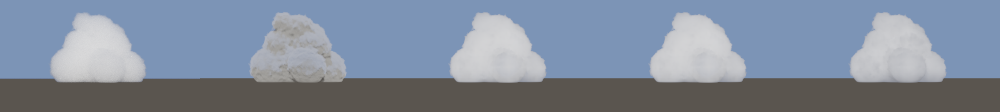 |
| 15 | (-0.243, 0.342, -0.908) | 4096 | 0.0003844 | 0 | 28878 | no | 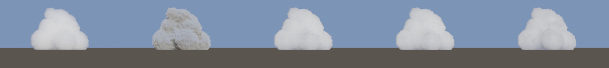 |
| 30 | (-0.470, 0.342, -0.814) | 4096 | 0.0003991 | 0 | 28878 | no | 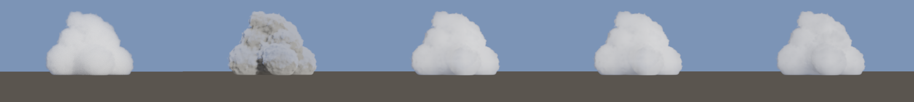 |
| 45 | (-0.664, 0.342, -0.664) | 4096 | 0.0004508 | 0 | 28878 | no | 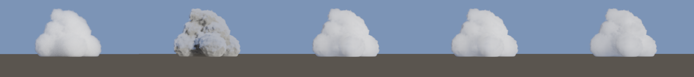 |
| 60 | (-0.814, 0.342, -0.470) | 4096 | 0.0005234 | 0 | 28878 | no | 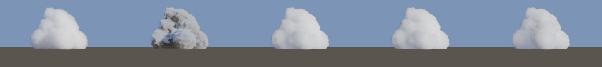 |
| 75 | (-0.908, 0.342, -0.243) | 4096 | 0.0006194 | 0 | 28878 | no | 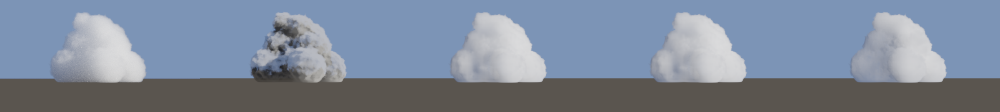 |
| 90 | (-0.940, 0.342, -0.000) | 4096 | 0.000674 | 0 | 28878 | no | 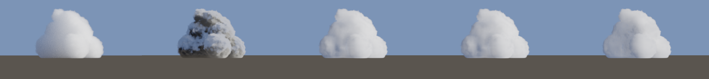 |
| 105 | (-0.908, 0.342, 0.243) | 4096 | 0.0006713 | 0 | 28878 | no | 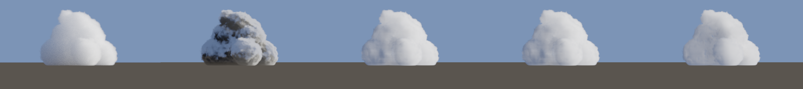 |
| 120 | (-0.814, 0.342, 0.470) | 4096 | 0.000694 | 0 | 28878 | no | 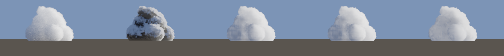 |
| 135 | (-0.664, 0.342, 0.664) | 4096 | 0.0007534 | 0 | 28878 | no | 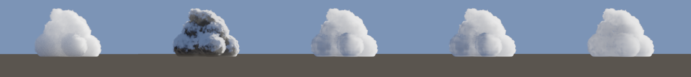 |
| 150 | (-0.470, 0.342, 0.814) | 4096 | 0.0007533 | 0 | 28878 | no | 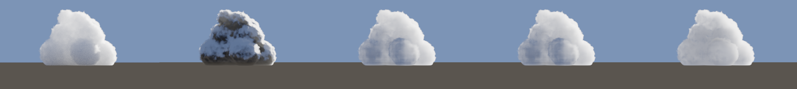 |
| 165 | (-0.243, 0.342, 0.908) | 4096 | 0.0007427 | 0 | 28878 | no |  |
| 180 | (-0.000, 0.342, 0.940) | 4096 | 0.0007036 | 0 | 28878 | no | 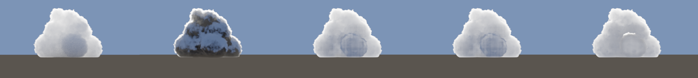 |

## Bias sources

- reference: Monte Carlo noise (estimated above) and the path tracer bounce cap.
- analytic: ray-march discretization, octave multiple-scattering approximation, two-direction ambient term.
- neural: ray-march discretization, network approximation of the in-scattered radiance, Monte Carlo noise in training targets; shader_ml uses fp16 weights with fp32 activations and accumulation.
